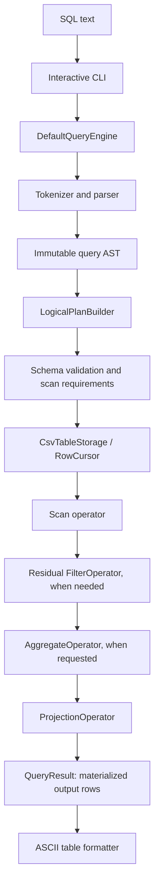

# Mini SQL Query Executor

Mini SQL Query Executor is a small Java 21 project for experimenting with how a
SQL query can be tokenized, parsed, planned, and run against CSV data. It is an
educational executor, not a production database. Its design emphasizes clear
layer boundaries, immutable query structures, pull-based row processing,
resource cleanup, and optimizations that can be inspected with `EXPLAIN`.

## Project coordinates

- Maven group ID: `io.github.payal1762005`
- Artifact ID: `mini-sql-query-executor`
- Current version: `1.0-SNAPSHOT`
- Java package namespace: `io.github.payal1762005.minisql`

GitHub profile: <https://github.com/Payal1762005>

## Features

- Parses a supported `SELECT` subset into an immutable AST.
- Reads CSV tables from a configurable directory using Apache Commons CSV.
- Executes through closeable, pull-based scan, filter, projection, and aggregate
  operators.
- Supports simple column-to-literal WHERE comparisons and boolean expressions.
- Supports grouping and `COUNT`, `SUM`, `AVG`, `MIN`, and `MAX`.
- Provides `EXPLAIN` plans without opening a row scan.
- Pushes required-column selection and eligible comparisons into the CSV scan.
- Keeps serial aggregation as the default, with opt-in bounded parallel
  aggregation for aggregate queries.
- Provides an interactive CLI with formatted output and `help`, `tables`, and
  `exit` commands.
- Includes an opt-in JMH benchmark profile for repeatable performance
  experiments.

## Technology stack

| Component | Version / role |
|---|---|
| Java | 21 |
| Maven | 3.x; Maven 3.8+ is recommended, but the project does not enforce a Maven minimum |
| Apache Commons CSV | 1.14.1, CSV parsing |
| JUnit Jupiter | 5.10.2, test scope |
| JMH | 1.37, benchmarks-only Maven profile |

Maven compiler and test plugins are configured in `pom.xml`. The JMH profile
also uses build-helper and shade plugins to compile `src/jmh/java` and produce
an executable benchmark jar. JMH is not part of the ordinary application or
test dependencies.

## Prerequisites and setup

Install a JDK 21 distribution and Maven 3.x. Confirm the tools are available:

```shell
java -version
mvn -version
```

Clone the repository, enter its directory, and build:

```shell
git clone <repository-url>
cd mini-sql-query-executor
mvn clean package
```

Run the complete JUnit suite:

```shell
mvn test
```

The sample table is `src/main/resources/data/employees.csv`. CSV table files
must have a header row; table and column identifiers are resolved with exact,
case-sensitive matching.

The bundled employee dataset is entirely synthetic and does not represent real
people. Employee identifiers, names, departments, job titles, salaries, and
dates are fictional sample values.

## Running the CLI

Start the interactive CLI from the project directory. By default, CSV files are
read from `src/main/resources/data`:

```shell
mvn compile exec:java
```

Pass a directory containing CSV files as the first application argument to use
a different data directory:

```powershell
mvn compile exec:java "-Dexec.args=C:\data\mini-sql"
```

On Unix-like shells, use a Unix path:

```shell
mvn compile exec:java -Dexec.args=/data/mini-sql
```

Enter SQL statements terminated by semicolons. Statements can span lines, and
multiple SQL statements can be entered on one line. The semicolon inside a
quoted SQL string does not terminate a statement. Available CLI commands are:

| Command | Action |
|---|---|
| `help` | Display CLI usage |
| `tables` | List `.csv` files in the configured data directory |
| `exit` | End the session |

Example session:

```text
Mini SQL Query Executor
Enter SQL terminated by ';'. Type help for commands.
sql> tables
Tables:
  employees
sql> SELECT first_name, department
...> FROM employees
...> WHERE salary > 150000;
+-------------+------------+
| first_name  | department |
+-------------+------------+
| Employee007 | NebulaLab  |
| Employee010 | OrbitOps  |
+-------------+------------+
(2 rows)
sql> SELECT first_name FROM employees WHERE employee_id = 9999;
(0 rows)
sql> exit
Goodbye.
```

The result formatter sizes columns to their contents, displays null values as
`NULL`, and escapes embedded line breaks, carriage returns, and tabs.

## SQL examples

All examples use the actual sample table and columns:
`employee_id`, `first_name`, `last_name`, `department`, `job_title`, `salary`,
and `hire_date`.

Select one or more columns, or all columns in CSV schema order:

```sql
SELECT first_name, last_name FROM employees;
SELECT * FROM employees;
```

Column aliases use `AS`:

```sql
SELECT first_name AS employee_name, salary AS annual_salary
FROM employees;
```

WHERE supports `=`, `!=`, `<>`, `>`, `<`, `>=`, and `<=` with single-quoted
string, unsigned integer, or unsigned decimal literals. SQL string literals
escape an apostrophe by doubling it:

```sql
SELECT first_name, salary
FROM employees
WHERE salary >= 100000;

SELECT first_name, department
FROM employees
WHERE department = 'OrbitOps';
```

Boolean expressions support `AND`, `OR`, parentheses, and normal precedence
(`AND` binds more tightly than `OR`):

```sql
SELECT first_name, department, salary
FROM employees
WHERE department = 'OrbitOps'
  AND (salary < 120000 OR salary > 150000);
```

`GROUP BY` accepts one or more columns. Aggregate functions are `COUNT(*)`,
`COUNT(column)`, `SUM(column)`, `AVG(column)`, `MIN(column)`, and `MAX(column)`:

```sql
SELECT department, COUNT(*) AS employee_count, AVG(salary) AS average_salary
FROM employees
GROUP BY department;

SELECT COUNT(*), SUM(salary), MIN(salary), MAX(salary)
FROM employees;
```

`EXPLAIN` returns a readable logical plan as result rows and does not open a
table scan:

```sql
EXPLAIN
SELECT first_name
FROM employees
WHERE salary > 90000;
```

For this query, the plan includes a projection and a scan whose details show
the requested columns and pushed predicate. The plan is informational; it does
not report measured costs.

The logical plan has this shape:

```text
Projection: first_name
  Scan: table=employees, columns=[first_name, salary], pushed=[salary > 90000]
```

Aggregation is serial by default. Applications can opt in to parallel
aggregation with the public engine configuration; worker count also bounds
in-flight batches, while batch size controls the number of input rows processed
by each worker task:

```java
var config = AggregationExecutionConfig.parallel(4, 1024);
var engine = new DefaultQueryEngine(new CsvTableStorage(), config);
var result = engine.execute(
        "SELECT department, AVG(salary) FROM employees GROUP BY department");
```

Use the existing constructor to retain serial aggregation:

```java
var engine = new DefaultQueryEngine(new CsvTableStorage());
```

`EXPLAIN` identifies the selected aggregate operator. In parallel mode it
includes the worker count, batch size, and in-flight batch limit. Parallel
aggregation still reads the child scan sequentially; only batch aggregation is
parallelized. It is an opt-in execution strategy, not a guaranteed performance
improvement.

## Architecture

The responsibilities are separated by layer:

- **Tokenizer and parser (`parser`)**: turn SQL text into position-aware tokens,
  then parse the supported grammar into the AST.
- **AST (`model`)**: immutable query, expression, literal, schema, row, and
  logical-plan data types.
- **Planner (`planner`)**: resolve names against the table schema, validate
  aggregate/grouping combinations, determine scan columns and eligible
  predicates, then build the operator pipeline. `explain` constructs plan
  metadata without constructing a scan operator.
- **Engine (`engine`)**: the stable `QueryEngine` API; `DefaultQueryEngine`
  coordinates parse, plan, and execution. Its current `QueryResult` contains a
  materialized list of output rows.
- **Operators (`operators`)**: closeable, pull-based components for scanning,
  filtering, projection, and aggregation.
- **Storage (`storage`)**: `TableStorage` abstracts schemas and scans;
  `CsvTableStorage` implements CSV access and `RowCursor` exposes lazy row
  iteration.
- **CLI (`cli`)**: reads statements and built-in commands, calls the public
  engine API, and formats returned rows. It does not parse or plan SQL itself.



The operator pipeline follows pull semantics: the consumer asks the outer
operator whether it has another row, then requests that row. The request travels
through parent operators toward storage, which advances a CSV cursor only as
needed. Each matching input record is returned as a row and passed through the
remaining operators. Exhaustion, explicit close, or failures close the child
resources. Grouped and global aggregation are an exception to strictly
row-at-a-time output: on its first output request, `AggregateOperator` consumes
its input and retains per-group aggregate state before producing result rows.
The engine then collects all output rows because the current `QueryResult` API
is materialized.

## Optimization details

**Projection pushdown** computes the source columns needed by SELECT, WHERE,
GROUP BY, and aggregate arguments. For `SELECT *`, all schema columns are
requested. The CSV cursor creates output rows with only the requested fields,
preserving their requested order; columns needed for predicates or aggregation
are still included before those operators run.

**Predicate pushdown** currently accepts a simple `column comparison literal`,
or a WHERE tree containing only such comparisons connected by `AND`. The CSV
cursor evaluates those comparisons against parsed CSV record fields before
constructing a `Row`, avoiding row construction and Java filter processing for
records that do not match. Comparison order is retained. If the expression
contains any `OR`, the complete WHERE expression remains a residual
`FilterOperator` expression. This conservative rule avoids changing logical
grouping and short-circuit evaluation behavior.

`EXPLAIN` marks pushed predicates in the scan details and residual conditions
in a `Filter` node. It validates the schema and referenced columns but does not
open a row cursor.

`CsvTableStorage` performs predicate evaluation before creating matching
`Row` objects. For compatibility, custom `TableStorage` implementations that
do not override the predicate-aware scan method use the interface's default
adapter: that adapter obtains rows from the existing projected scan, evaluates
predicates, and returns matching rows. It preserves behavior but does not
provide the CSV implementation's pre-`Row` allocation avoidance.

CSV scans remain sequential and parse each record. Predicate pushdown does not
skip CSV bytes, and projection pushdown does not guarantee less file I/O.
Neither optimization guarantees a query speedup; measure with the benchmark
setup on the target environment.

## Benchmarking

JMH benchmarks are isolated in `src/jmh/java` and enabled with the `benchmarks`
Maven profile. Build the runnable jar:

```powershell
mvn -Pbenchmarks -DskipTests package
```

Run the complete benchmark matrix:

```powershell
java -Xms2g -Xmx2g -jar target\mini-sql-query-executor-1.0-SNAPSHOT-benchmarks.jar
```

The benchmark guide, [`BENCHMARKS.md`](BENCHMARKS.md), includes a quick smoke
command and CSV output options. JMH generates deterministic temporary employee-
like CSV data with configurable row counts (1,000, 100,000, 1,000,000), extra
column count, uniform or clustered data distribution, predicate selectivity,
and storage variant. Scenarios include full scan, narrow projection, selective
filter, filter plus projection, and grouped average. The two filter scenarios
currently use the same SQL query and should not be interpreted as distinct
workloads.

JMH runs average-time and throughput modes. Since the benchmark class configures
milliseconds as its output time unit, throughput is reported as operations per
millisecond (`ops/ms`); multiply by 1,000 for queries per second. An estimated
input-row throughput is queries per second multiplied by the dataset row count;
it is not the number of rows returned by a filtered query. Average time is
reported as `ms/op`. The optional `-prof gc` profiler reports allocation and
garbage-collection metrics such as normalized bytes per operation. See
`BENCHMARKS.md` for warm-up, measurement, fork defaults, JVM considerations,
and limitations.

A previous short smoke run used JDK 21.0.10, 1,000 rows, 16 extra columns, 50%
uniform selectivity, one warm-up iteration, two measurement iterations, and one
fork, with `-Xms1g -Xmx1g` and JMH's GC profiler enabled. The exact benchmark
selection and parameters were:

```powershell
java -Xms1g -Xmx1g -jar target\mini-sql-query-executor-1.0-SNAPSHOT-benchmarks.jar `
  '.*selectiveFilter' -p rowCount=1000 -p extraColumnCount=16 `
  -p predicateSelectivityPercent=50 -p dataDistribution=uniform `
  -p executionVariant=optimized,baseline -wi 1 -i 2 -w 1s -r 1s -f 1 -prof gc
```

It reported:

| Query / variant | Average time | Throughput | Normalized allocation |
|---|---:|---:|---:|
| Selective filter / optimized | 3.751 ms/op | 0.250 ops/ms | 2,125,214 B/op |
| Selective filter / baseline | 4.514 ms/op | 0.186 ops/ms | 4,473,371 B/op |

These are preliminary smoke measurements, not definitive performance claims.
The short run has limited iterations and one fork; timing varies with the JVM,
hardware, filesystem/cache state, and system load. Re-run the documented JMH
matrix with adequate warm-up and forks before drawing conclusions. CSV bytes
read are not reduced by predicate pushdown.

## Limitations and future improvements

Current limitations:

- SQL support is intentionally restricted to the documented SELECT subset;
  there are no joins, subqueries, ORDER BY, LIMIT, or additional statement
  types.
- Table names, source columns, and aliases use exact, case-sensitive matching.
  SQL keywords are case-insensitive. Aliases require `AS`, are output labels,
  and are not resolved in WHERE or GROUP BY.
- WHERE supports column-to-literal comparisons; comparisons involving two
  columns, NULL literals, signed numeric literals, and other predicate forms
  are not supported. A null value encountered by a supported comparison is an
  execution error rather than SQL three-valued logic. String comparisons are
  lexicographic; numeric comparisons use `BigDecimal`.
- A selected non-aggregate column in an aggregate query must also be listed in
  `GROUP BY`; `SELECT *` cannot be combined with aggregates.
- `COUNT(column)` counts non-null values without requiring numeric data.
  `SUM`, `AVG`, `MIN`, and `MAX` require numeric input values. `AVG` uses four
  decimal places with HALF_UP rounding.
- The engine materializes query output in `QueryResult`; it is not a streaming
  client API. Grouped aggregation retains aggregate state for all groups.
- CSV scans do not use indexes and read/parse the input sequentially.
- The default predicate-aware storage adapter preserves custom-storage
  compatibility, but only storage implementations that override the method
  can evaluate predicates before materializing rows.
- The benchmark suite is a starting point for local comparisons, not a
  cross-machine performance guarantee. Its selective-filter and filter-plus-
  projection benchmark methods currently execute identical SQL.

Potential future work includes broader SQL syntax, a streaming result API,
indexed or columnar storage, richer optimizer rules, and more distinct benchmark
workloads. These are not implemented features.
